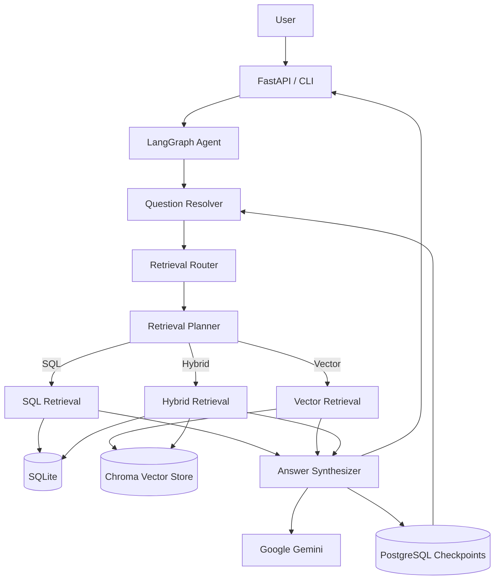

# HelpDesk AI Agent

A hybrid AI agent for enterprise IT help-desk support, built with LangGraph, FastAPI, Gemini, SQL, and vector search.

The agent combines structured enterprise data with semantic document retrieval to answer factual, troubleshooting, and cross-source questions. It automatically decides whether a question requires SQL retrieval, vector search, or both.

The project uses a fictional enterprise help-desk dataset and is designed as a realistic demonstration of agentic retrieval, conversational memory, persistence, testing, and containerized deployment.

## Overview

Traditional retrieval systems often treat structured data and unstructured documents as separate information sources.

Enterprise support environments typically contain both.

Structured systems contain data such as:

- users
- departments
- assets
- software versions
- support tickets
- incidents
- changes

Unstructured sources contain information such as:

- knowledge-base articles
- incident reports
- runbooks
- support emails
- release notes

HelpDesk AI Agent provides a single conversational interface over both types of information.

For example:

> How many open Critical VPN tickets are there?

This requires structured database retrieval.

> How do I troubleshoot VPN after a Windows update?

This requires semantic document retrieval.

> Which users have open VPN tickets and what KB article should support follow?

This requires both.

The agent dynamically selects the appropriate retrieval strategy before generating an answer.

## Features

- LangGraph-based agent workflow
- Automatic SQL, vector, or hybrid routing
- LLM-generated retrieval plans
- Structured help-desk data retrieval
- Semantic document search
- Hybrid retrieval across SQL and vector data
- Gemini-based answer synthesis
- Context-aware follow-up questions
- Persistent conversation memory
- PostgreSQL-backed LangGraph checkpoints
- Local Hugging Face embedding model
- FastAPI REST API
- Interactive command-line interface
- Docker and Docker Compose support
- Automated unit and integration tests
- Test coverage reporting
- GitHub Actions CI
- Docker container smoke testing
- Lazy initialization of external model clients

## Architecture



### Storage responsibilities

| Technology | Responsibility |
| --- | --- |
| SQLite | Structured fictional enterprise help-desk data |
| Chroma | Vector embeddings and semantic document retrieval |
| PostgreSQL | Persistent LangGraph conversation checkpoints |
| Hugging Face MiniLM | Local document and query embeddings |
| Google Gemini | Routing, planning, question resolution, and answer synthesis |

## How the Agent Works

Each question moves through a LangGraph workflow.

```text
Question
   ↓
Resolve conversational context
   ↓
Classify retrieval route
   ↓
Create retrieval plan
   ↓
Retrieve evidence
   ↓
Generate grounded answer
   ↓
Save conversation turn
```

### 1. Question resolution

The agent first checks whether the current question depends on previous conversation context.

For example:

```text
User:
Which users have open VPN tickets?

User:
Which of them are in Finance?
```

The second question is rewritten internally as a standalone question:

```text
Which users with open VPN tickets are in Finance?
```

This allows downstream routing and retrieval components to work with a complete question.

### 2. Retrieval routing

The router classifies the question into one of three routes:

- `sql`
- `vector`
- `hybrid`

### 3. Retrieval planning

The planner converts the standalone question into retrieval instructions.

For example:

```text
Question:
How many open Critical VPN tickets are there?

SQL query:
count open Critical VPN tickets
```

Or:

```text
Question:
How do I troubleshoot VPN after a Windows update?

Vector query:
VPN connection failure after Windows update troubleshooting
```

A hybrid question can generate both retrieval queries.

### 4. Evidence retrieval

The selected retrieval nodes collect relevant evidence from the structured database, vector database, or both.

### 5. Answer synthesis

Gemini receives the original user question and the retrieved evidence.

The synthesizer is instructed to answer using the available evidence rather than relying on unsupported assumptions.

### 6. Conversation checkpointing

The completed conversation turn is stored through a LangGraph checkpointer.

When PostgreSQL checkpointing is configured, conversations survive application and container restarts.

## Retrieval Routes

### SQL retrieval

SQL retrieval is used for exact structured information.

Examples:

```text
How many open Critical VPN tickets are there?
```

```text
Which department has the most laptop tickets?
```

```text
List unresolved SEV1 incidents.
```

The SQL retrieval layer searches the fictional enterprise help-desk database.

### Vector retrieval

Vector retrieval is used for semantic document search.

Examples:

```text
How do I troubleshoot VPN after a Windows update?
```

```text
What should I check when Azure SSO fails?
```

```text
Find runbooks about database timeouts.
```

Documents are embedded locally using:

```text
sentence-transformers/all-MiniLM-L6-v2
```

The embeddings are stored in Chroma.

### Hybrid retrieval

Hybrid retrieval combines structured and semantic evidence.

Examples:

```text
Which users have open VPN tickets and what KB article should support follow?
```

```text
Are there Critical Azure Login tickets that match known conditional access issues?
```

```text
Which recent changes may be related to unresolved SEV1 incidents?
```

```text
Find departments affected by printer issues and summarize the recommended troubleshooting steps.
```

A hybrid question can retrieve structured records from SQLite and troubleshooting guidance from Chroma before generating a single answer.

## Technology Stack

### Agent and AI

- Python
- LangGraph
- LangChain
- Google Gemini
- Hugging Face sentence-transformers

### Data

- SQLite
- Chroma
- PostgreSQL
- Psycopg

### API

- FastAPI
- Uvicorn
- Pydantic

### Testing

- pytest
- pytest-cov
- FastAPI TestClient

### Infrastructure

- Docker
- Docker Compose
- GitHub Actions

## Project Structure

```text
helpdesk-ai-agent/
├── .github/
│   └── workflows/
│       └── tests.yml
│
├── app/
│   ├── agent/
│   │   ├── checkpoint.py
│   │   ├── graph.py
│   │   ├── nodes.py
│   │   ├── planner.py
│   │   ├── resolver.py
│   │   ├── router.py
│   │   ├── state.py
│   │   └── synthesizer.py
│   │
│   ├── api/
│   │   ├── application.py
│   │   ├── routes.py
│   │   └── schemas.py
│   │
│   ├── database/
│   │   ├── connection.py
│   │   ├── initialize.py
│   │   ├── models.py
│   │   └── search.py
│   │
│   ├── vector/
│   │   ├── constants.py
│   │   ├── embeddings.py
│   │   ├── loader.py
│   │   └── search.py
│   │
│   ├── config.py
│   ├── llm.py
│   ├── main.py
│   └── service.py
│
├── data/
│   └── raw/
│       └── enterprise_dataset/
│           ├── documents/
│           │   ├── incident_reports/
│           │   ├── kb_articles/
│           │   ├── release_notes/
│           │   ├── runbooks/
│           │   └── support_emails/
│           │
│           └── sql/
│               ├── assets.csv
│               ├── changes.csv
│               ├── incidents.csv
│               ├── software_versions.csv
│               ├── tickets.csv
│               └── users.csv
│
├── runtime/
│   ├── chroma/
│   └── helpdesk.db
│
├── tests/
│   ├── agent/
│   ├── api/
│   ├── database/
│   ├── vector/
│   ├── test_llm.py
│   └── test_service.py
│
├── .dockerignore
├── .env.example
├── .gitignore
├── compose.yaml
├── Dockerfile
├── docker-entrypoint.sh
├── pyproject.toml
└── README.md
```

The `runtime/` directory contains generated application data and is not part of the source dataset.

## Dataset

The project includes a fictional enterprise help-desk dataset.

No production or real customer data is required.

### Structured data

CSV source files are located in:

```text
data/raw/enterprise_dataset/sql/
```

The dataset contains:

```text
users.csv
assets.csv
software_versions.csv
tickets.csv
incidents.csv
changes.csv
```

These files are used to initialize the SQLite database.

### Documents

Unstructured documents are located in:

```text
data/raw/enterprise_dataset/documents/
```

Document categories include:

```text
kb_articles
incident_reports
runbooks
support_emails
release_notes
```

The vector loader splits these documents into chunks, generates embeddings, and stores them in Chroma.

## Getting Started

### Prerequisites

For local development:

- Python 3.13+
- Git
- a Google Gemini API key

For containerized execution:

- Docker
- Docker Compose

## Environment Variables

Copy the example environment file:

```bash
cp .env.example .env
```

On Windows Command Prompt:

```cmd
copy .env.example .env
```

Configure:

```env
GOOGLE_API_KEY=your_gemini_api_key
GEMINI_MODEL=your_gemini_model
EMBEDDING_MODEL=sentence-transformers/all-MiniLM-L6-v2

CHECKPOINT_DATABASE_URL=
LANGGRAPH_STRICT_MSGPACK=true
```

### `GOOGLE_API_KEY`

API key used to access Google Gemini.

### `GEMINI_MODEL`

Gemini model used by the agent.

### `EMBEDDING_MODEL`

Hugging Face model used for local embeddings.

The default project model is:

```text
sentence-transformers/all-MiniLM-L6-v2
```

### `CHECKPOINT_DATABASE_URL`

PostgreSQL connection URL used by the LangGraph checkpointer.

When empty:

```env
CHECKPOINT_DATABASE_URL=
```

the application uses LangGraph's in-memory checkpointer.

When running through Docker Compose, the application is configured to use the PostgreSQL service.

### `LANGGRAPH_STRICT_MSGPACK`

Enables strict MessagePack deserialization for LangGraph checkpoint data.

## Local Development Setup

Create a virtual environment:

```bash
python -m venv .venv
```

Activate it.

### Windows

```bash
.venv\Scripts\activate
```

### Git Bash

```bash
source .venv/Scripts/activate
```

### Linux or macOS

```bash
source .venv/bin/activate
```

Install the project in editable mode with test dependencies:

```bash
python -m pip install -e ".[test]"
```

## Initialize the Structured Database

Run:

```bash
python -m app.database.initialize
```

This creates:

```text
runtime/helpdesk.db
```

and imports the CSV source data.

## Build the Vector Database

Run:

```bash
python -m app.vector.loader
```

This:

1. loads the source documents;
2. splits them into chunks;
3. generates local embeddings;
4. stores the vectors in Chroma.

Generated vector data is stored in:

```text
runtime/chroma/
```

The first run may download the configured Hugging Face embedding model.

## Run the CLI

Start the interactive agent:

```bash
python -m app.main
```

Example:

```text
HelpDesk AI Agent
Type "exit" or "quit" to stop.

You: Which users have open VPN tickets?

Agent: ...

You: Which of them are in Finance?

Agent: ...
```

A single CLI process uses one conversation ID, allowing follow-up questions to use previous context.

Enter:

```text
exit
```

or:

```text
quit
```

to stop the CLI.

## Run the API

Start FastAPI:

```bash
uvicorn app.api.application:app --reload
```

The API is available at:

```text
http://localhost:8000
```

FastAPI interactive documentation is available at:

```text
http://localhost:8000/docs
```

OpenAPI documentation is available at:

```text
http://localhost:8000/redoc
```

## API Usage

### Health check

```bash
curl http://localhost:8000/health
```

Response:

```json
{
  "status": "ok"
}
```

The health endpoint does not require the Gemini or embedding models to be initialized.

### Ask a question

```bash
curl -X POST http://localhost:8000/ask \
  -H "Content-Type: application/json" \
  -d '{
    "question": "How many open Critical VPN tickets are there?"
  }'
```

Example response:

```json
{
  "answer": "There are 2 open Critical VPN tickets.",
  "conversation_id": "550e8400-e29b-41d4-a716-446655440000"
}
```

When no `conversation_id` is provided, the API generates one.

### Continue a conversation

Send the returned conversation ID with the next request:

```bash
curl -X POST http://localhost:8000/ask \
  -H "Content-Type: application/json" \
  -d '{
    "question": "Which users have open VPN tickets?",
    "conversation_id": "demo-conversation"
  }'
```

Then:

```bash
curl -X POST http://localhost:8000/ask \
  -H "Content-Type: application/json" \
  -d '{
    "question": "Which of them are in Finance?",
    "conversation_id": "demo-conversation"
  }'
```

The agent uses the previous conversation turn to resolve the meaning of `them`.

A different conversation ID creates an isolated conversation.

## Conversational Memory

Conversation state is managed through LangGraph checkpointing.

### Local execution

When no PostgreSQL checkpoint URL is configured:

```text
InMemorySaver
```

is used.

Conversation state exists only for the lifetime of the Python process.

### Docker Compose

Docker Compose configures a PostgreSQL-backed LangGraph checkpointer.

The PostgreSQL service stores:

- graph checkpoints
- thread state
- conversation history

As a result, a conversation can continue after the API container is restarted, provided the same `conversation_id` is reused.

For example:

```text
Request 1
conversation_id = persistent-demo

        ↓

Restart API container

        ↓

Request 2
conversation_id = persistent-demo

        ↓

Previous conversation state is restored
```

PostgreSQL is currently used only for LangGraph checkpoints.

The fictional enterprise relational data remains in SQLite.

## Lazy Model Initialization

External model clients are initialized lazily.

The Gemini client is created only when the agent requires an LLM operation.

The Hugging Face embedding model is created only when vector retrieval is required.

Both clients are cached after their first initialization.

This prevents operations such as:

```text
GET /health
```

from unnecessarily loading AI models.

It also improves test isolation and application startup behavior.

## Docker

The complete application stack can be started with Docker Compose.

Build and start:

```bash
docker compose up --build
```

Or run in the background:

```bash
docker compose up --build -d
```

Check container status:

```bash
docker compose ps
```

View logs:

```bash
docker compose logs -f
```

View only application logs:

```bash
docker compose logs -f helpdesk-agent
```

Stop the stack:

```bash
docker compose down
```

Remove containers and volumes:

```bash
docker compose down -v
```

### Docker services

The Compose stack contains:

```text
postgres
helpdesk-agent
```

The PostgreSQL container stores LangGraph checkpoints.

The application container runs the FastAPI service.

### Container initialization

The application entrypoint checks whether generated runtime data already exists.

If the SQLite database is missing:

```bash
python -m app.database.initialize
```

is executed.

If the Chroma database is missing:

```bash
python -m app.vector.loader
```

is executed.

The LangGraph PostgreSQL checkpoint tables are then initialized before Uvicorn starts.

Generated application data is stored in Docker volumes.

## Testing

Run the complete test suite:

```bash
pytest
```

Verbose output:

```bash
pytest -v
```

Run tests with coverage:

```bash
pytest --cov=app --cov-report=term-missing
```

Run a specific test module:

```bash
pytest tests/agent/test_memory_integration.py -v
```

### Test categories

The test suite includes:

- agent node unit tests
- graph compilation tests
- routing and planning tests
- question resolver tests
- answer synthesizer tests
- SQL search unit tests
- SQL retrieval integration tests
- vector search tests
- embedding initialization tests
- checkpoint initialization tests
- conversational memory integration tests
- service tests
- FastAPI endpoint tests

### Conversational memory integration tests

The memory integration tests use:

```text
real LangGraph StateGraph
real InMemorySaver
fake deterministic agent nodes
```

They verify two important properties:

```text
same thread ID
→ previous conversation history is restored
```

and:

```text
different thread IDs
→ conversation histories remain isolated
```

External AI services are not required for these tests.

## Continuous Integration

GitHub Actions runs CI for pushes and pull requests.

The workflow contains two jobs.

### Python tests

The first job:

1. checks out the repository;
2. installs Python;
3. installs the project and test dependencies;
4. runs pytest;
5. generates terminal coverage output.

### Docker smoke test

The second job:

1. builds the Docker images;
2. starts PostgreSQL;
3. starts the application container;
4. initializes runtime databases;
5. waits for the API;
6. calls `/health`;
7. validates the health response;
8. prints container status and logs;
9. shuts down the Compose stack.

The smoke test verifies that the deployable container stack can start successfully from a clean environment.

## Example Questions

### SQL

```text
How many open Critical VPN tickets are there?
```

```text
Which department has the most laptop tickets?
```

```text
List unresolved SEV1 incidents.
```

### Vector

```text
How do I troubleshoot VPN after a Windows update?
```

```text
What should I check when Azure SSO fails?
```

```text
Find runbooks about database timeouts.
```

### Hybrid

```text
Which users have open VPN tickets and what KB article should support follow?
```

```text
Are there Critical Azure Login tickets that match known conditional access issues?
```

```text
Which recent changes may be related to unresolved SEV1 incidents?
```

```text
Find departments affected by printer issues and summarize the recommended troubleshooting steps.
```

### Conversational

```text
Which users have open VPN tickets?
```

Followed by:

```text
Which of them are in Finance?
```

## Current Limitations

This project currently has several intentional architectural limitations.

### SQLite structured storage

The fictional enterprise data is stored in SQLite.

This works well for local development and a single application instance, but it is not suitable for horizontally scaled application replicas.

### Local Chroma storage

Chroma currently uses local persistent storage.

Multiple independent application replicas should not maintain separate vector indexes.

### Natural-language SQL retrieval layer

The SQL retrieval layer currently maps planned natural-language retrieval descriptions to supported help-desk search operations.

It is not a general-purpose text-to-SQL engine.

### Single-document corpus

The current document collection is fictional and intentionally generated for this project.

Retrieval quality in a production environment would depend on document quality, metadata, chunking strategy, and embedding evaluation.

### External LLM dependency

Routing, retrieval planning, conversational question resolution, and answer synthesis currently depend on Google Gemini.

### No authentication or authorization

The API currently has no user authentication or role-based access control.

A production enterprise agent would require identity and authorization controls before exposing help-desk data.

## Roadmap

Planned architectural improvements include:

- migrate structured help-desk data from SQLite to PostgreSQL;
- migrate vector storage from Chroma to pgvector or a managed vector service;
- consolidate shared persistence for cloud deployment;
- add Azure Container Apps infrastructure;
- add automated Azure deployment through GitHub Actions;
- add API authentication and authorization;
- add structured logging and observability;
- add retrieval quality evaluation;
- add LLM response evaluation;
- add tracing for LangGraph executions;
- add configurable model providers;
- add production-grade conversation retention policies;
- evaluate deployment through Microsoft Foundry Agent Service.

## Development Principles

The project is developed using small, focused commits.

The implementation emphasizes:

- separation of concerns
- explicit agent state
- deterministic retrieval boundaries
- testable graph nodes
- isolated external model clients
- lazy resource initialization
- persistent conversational state
- container reproducibility
- CI validation

The goal is not only to demonstrate an AI chatbot, but to explore how an enterprise-style hybrid retrieval agent can be structured, tested, persisted, and prepared for deployment.

## License

This project is licensed under the MIT License. See [LICENSE](LICENSE).
